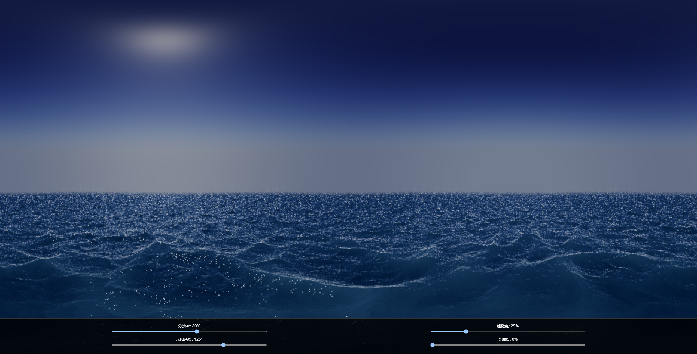

图形渲染代码功能文档


## 一、概述
本代码将大气散射模型与物理渲染（PBR）方案结合，实现天空、海洋等自然场景的可视化效果。通过大气参数预设、PBR光照计算、动态海面高度场生成以及光线追踪等技术组件的协同应用，构建完整的渲染系统。该方案包含参数化的大气散射计算、基于物理的材质表现、实时海洋波动效果等
## 二、未汇报完的

为了实现对小球的全局光照，在渲染时会提前以一般分辨率，在小球位置渲染一张全景图,这样全景图在后续的正式渲染中被当作小球的环境贴图传递



在之后的渲染中,为了得到相应的粗糙度上的环境光的效果
要进行重要性采样
```wgsl
fn sample_ggx_vndf(viewer_dir: vec3<f32>, alpha: vec2<f32>, hash: vec2<f32>) -> vec3<f32> {
    // Improved GGX importance sampling function by zombye
    // https://ggx-research.github.io/publication/2023/06/09/publication-ggx.html

    // Transform viewer direction to the hemisphere configuration
    var v_dir = normalize(vec3<f32>(alpha * viewer_dir.xy, viewer_dir.z));

    // Sample a reflection direction off the hemisphere
    let tau: f32 = 6.2831853; // 2 * PI
    let phi: f32 = tau * hash.x;
    let cos_theta: f32 = fma(1.0 - hash.y, 1.0 + v_dir.z, -v_dir.z);
    let sin_theta: f32 = sqrt(clamp(1.0 - cos_theta * cos_theta, 0.0, 1.0));
    let reflected: vec3<f32> = vec3<f32>(
        vec2<f32>(cos(phi), sin(phi)) * sin_theta,
        cos_theta
    );

    // Evaluate halfway direction
    let halfway: vec3<f32> = reflected + v_dir;

    // Transform back to hemiellipsoid configuration
    return normalize(vec3<f32>(
        alpha * halfway.xy,
        halfway.z
    ));
}
```
重要性采样就是当粗糙度较小时,我们得到的反射方向会偏向于法线方向,粗糙度较大时会比较分散,这样计算出来的光照也会更加模糊
但是,由于粗糙度比较大的时候,需要多次采样才能得到稳定的结果,所以我想了一些办法

```wgsl
fn fast_gaussian_5x5(uv: vec2<f32>) -> vec3<f32> {
    let texture_size = textureDimensions(env_texture);
    let inv_size = 1.0 / vec2<f32>(texture_size);
    var result = vec3<f32>(0.0);

    for (var i: i32 = -2; i <= 2; i++) {
        let offset = vec2<f32>(f32(i), 0.0) * inv_size;
        result += textureSample(env_texture, env_sampler, uv + offset).rgb * KERNEL_5[i + 2];
    }

    for(var i: i32 = -2; i <= 2; i++){
        let offset = vec2<f32>(0.0,f32(i)) * inv_size;
        result += textureSample(env_texture, env_sampler, uv + offset).rgb * KERNEL_5[i + 2];
    }
    result /= 2.0;
    return result;
}

fn sample_env_texture(dir: vec3<f32>, trash: bool) -> vec3<f32> {
    var uv: vec2<f32>;
    if (trash) {
        uv = vec2<f32>(0.0, 0.0);
    } else {
        uv = project_sky(dir);
    }
    uv.y = 1.0 - uv.y;
    
    return fast_gaussian_5x5(uv);
}
```
在采样的时候使用高斯模糊快速得到稳定的结果,但这样会导致粗糙度小的时候也得到模糊的结果
所以我在实现中
```wgsl
let microfacet_normal = tbn * sample_ggx_vndf(-(v * tbn),vec2(0.5),hash_uv);
```
固定了一个较大的粗糙度来得到一个粗糙时的结果
然后在渲染中
```wgsl
let env_color = get_env_color(p,nor,dir,sun_color,moon_color,trash);
```
通过直接计算得到一个完全清晰,粗糙度为0的结果
之后通过粗糙度进行混合得到结果
```wgsl
mix(scene_color * env_res,env_color,roughness) * (1 - roughness)
```
这样得到的效果:

<image src="image2.png">
<p align="center">(粗糙度为5%时的结果)<p>

<image src="image3.png">
<p align="center">(粗糙度为90%时的结果)<p>
<p align="center">以上结果删去了1 - roughness,以便于观察<p>

## 三、代码结构与模块功能


### 2.1 全局常量与结构体定义&#xA;


1.  **Uniforms 结构体**：作为全局统一变量的载体，存储着时间（`iTime`）、分辨率（`iResolution`）、太阳方向（`sun_dir`）以及球体相关数据（`ball_data`）。在渲染循环中，`iTime`会随时间推进更新，可用于实现动态效果，如太阳的移动、海面波浪的变化；`iResolution`决定了渲染画面的尺寸，影响纹理采样和坐标计算；`sun_dir`直接控制太阳在场景中的方向，进而影响光照效果；`ball_data`则为球体相关属性提供数据接口，便于动态调整球体外观。


2.  **Pos\_data 结构体**：虽目前代码中使用较少，但规划存储球体位置（`ball_pos`）、相机位置（`camera_pos`）和光源位置（`light_pos`）。在未来功能扩展中，可基于这些位置信息实现相机跟随、动态光源调整等功能，增强场景的交互性和动态性。


3.  **Material 结构体**：详细定义材质属性，反照率（`albedo`）决定物体表面的基础颜色；菲涅尔反射系数（`f0`）控制物体表面在不同视角下的反射强度；粗糙度（`roughness`）影响表面的光滑程度，进而改变光线反射和散射效果；金属度（`metallic`）用于区分金属与非金属材质，在 PBR 计算中发挥关键作用。不同材质的组合和参数调整，能够呈现出丰富多样的物体外观。


4.  **TracingResult 结构体**：专门用于存储光线追踪结果，记录光线与场景物体相交的距离（`distance`）、位置（`position`）以及命中类型（`hit_type`，0 代表海面，1 代表天空，2 代表球体）。这些信息为后续颜色计算和渲染提供重要依据，帮助确定光线在场景中的具体交互情况。


### 2.2 大气散射相关函数&#xA;


1.  **大气参数定义**

*   太阳、月亮相关参数：精确设定方向（`sun_dir`、`moon_dir`）、强度（`SUN_I`、`MOON_I`）、颜色（`SUNLIGHT_COLOR`、`MOONLIGHT_COLOR`）等。例如，通过调整`sun_dir`可模拟不同时间太阳在天空中的位置变化，进而改变光照角度和强度；`SUNLIGHT_COLOR`的设置直接影响阳光的色调，可营造出清晨、正午、黄昏等不同时间段的光照氛围。


*   行星和大气相关参数：明确行星半径（`PLANET_RADIUS`）、大气内半径（`ATMOSPHERE_INNER_RADIUS`）、外半径（`ATMOSPHERE_OUTER_RADIUS`）等。这些参数决定了大气的范围和形状，影响光线在大气中的传播路径和散射效果，是大气散射计算的基础。


*   查找表（LUT）相关参数：定义散射分辨率（`SCATTERING_RES`）、最小太阳天顶角余弦值（`MIN_MU_S`）等。查找表用于预计算和存储大气散射相关数据，提高计算效率。`SCATTERING_RES`影响查找表的精度，分辨率越高，计算结果越准确，但也会增加内存占用和计算成本。


1.  **大气散射计算函数**

*   `FADE`、`SUN_WEIGHT`、`SUN_RAISE`、`SUN_SET`等函数：通过数学计算精确模拟太阳在日出日落过程中的权重和状态变化。`FADE`函数根据太阳方向的`y`分量判断太阳是否接近地平线，返回相应的过渡值，用于调整光照强度和颜色；`SUN_WEIGHT`基于`FADE`的结果，计算太阳在当前状态下的权重，影响光照的整体贡献；`SUN_RAISE`和`SUN_SET`函数则通过比较太阳方向与特定阈值，判断太阳是否处于升起或落下阶段，为实现日出日落的动态效果提供逻辑支持。


*   `get_sun_exposure`和`get_sun_tint`函数：综合考虑日出日落以及蓝调时刻的影响，分别计算太阳的曝光强度和色调。在蓝调时刻，通过指数函数和线性插值，调整太阳的曝光强度和色调，使画面呈现出独特的蓝色调氛围；在日出日落阶段，根据太阳位置和时间变化，动态调整曝光和色调，模拟真实的光影变化。


*   `get_moon_exposure`和`get_moon_tint`函数：与太阳相关计算类似，用于计算月亮的曝光强度和色调。尽管当前代码中夜晚效果未充分展开，但这些函数为后续添加月亮光照效果奠定了基础。


*   `atmosphere_scattering`函数：作为大气散射计算的核心，该函数通过复杂的数学运算，结合太阳和月亮方向与光线方向，以及查找表采样，精确计算大气散射的颜色贡献。首先对光线方向和太阳、月亮方向进行参数预处理，包括计算角度、距离等相关量；然后通过一系列映射和转换，将这些参数映射到查找表的坐标空间，进行纹理采样；最后结合相位函数计算，综合考虑太阳和月亮的贡献，得出大气散射的最终颜色，为天空和场景提供真实的大气光照效果。


### 2.3 PBR 光照计算相关函数&#xA;


1.  **PBR 基础函数**

*   实现 GGX 法线分布函数（`distribution_ggx`）、Smith 单方向和双方向遮挡函数（`visibility_smith_ggx_single`、`visibility_smith_ggx_joint`）、菲涅尔近似函数（`fresnel_schlick`）以及介质菲涅尔计算函数（`fresnel_dielectric`）等。这些函数基于物理光学原理，精确描述光线在物体表面的反射、折射和散射行为。`distribution_ggx`用于计算微表面法线的分布概率，`visibility_smith_ggx_single`和`visibility_smith_ggx_joint`考虑物体表面的遮挡和阴影效应，`fresnel_schlick`和`fresnel_dielectric`模拟光线在不同介质界面的反射和折射现象。


*   `f0_to_ior`函数：将菲涅尔反射系数（`f0`）转换为折射率（`ior`），在计算介质菲涅尔反射和折射时起到关键作用，建立了材质属性与光学特性之间的联系。


1.  **漫反射计算函数**

*   `diffuse_hammon`函数：基于 Hammon 模型，充分考虑粗糙度、菲涅尔反射系数等因素，计算漫反射。通过对能量守恒因子、单次散射项和多次散射项的计算和调整，模拟光线在粗糙表面的漫反射效果，使物体表面呈现出符合物理规律的漫反射颜色和强度。


*   `diffuse_water`函数：专门针对水体的漫反射计算，考虑双向菲涅尔透射和水体的吸收效应。通过计算透射率、补偿因子以及单次散射项和多次散射项，模拟光线在水体中的传播和散射过程，使水体呈现出真实的漫反射效果，如水面的透光性和颜色变化。


1.  **PBR 着色函数**

*   `pbr_shading`和`pbr_shading_water`函数：分别用于普通材质和水体材质的 PBR 着色计算。在计算过程中，结合漫反射和高光反射的计算结果，考虑材质属性、光线方向、视角方向等因素，通过一系列数学运算，最终得出物体表面的着色结果。这些函数使物体在不同光照条件下呈现出真实的材质外观，如金属的光泽、塑料的质感、水体的透明和反射效果等。


### 2.4 海面相关函数&#xA;


1.  **海面高度场生成**

*   `sea_octave`函数：利用噪声函数生成海面的一个八度高度场。通过对噪声值的处理，如三角函数运算和混合操作，使生成的高度场具有自然的波浪起伏形态，为后续生成更复杂的海面高度场提供基础。


*   `map`和`map_detail`函数：通过多次调用`sea_octave`函数，并调整频率（`freq`）、振幅（`amp`）和粗糙度（`choppy`）等参数，生成不同细节程度的海面高度场。在循环过程中，不断变换参数，模拟海面波浪在不同尺度下的变化，从而实现从宏观到微观的海面细节表现。


1.  **海面相关计算**

*   `getNormal`函数：根据海面高度场，通过有限差分法计算海面法线。在三个坐标轴方向上计算高度场的变化量，进而得出法线方向，为计算海面的光照和反射效果提供关键信息，使海面能够正确反射光线，呈现出真实的光影效果。


*   `getSeaColor`和`getSeaColor_Ph`函数：计算海面颜色时，综合考虑菲涅尔反射、反射和折射成分、距离衰减以及高光等因素。通过计算菲涅尔反射系数，模拟不同视角下海面的反射强度变化；结合反射和折射光线的颜色计算，以及距离衰减和高光效果的添加，使海面颜色更加真实和丰富，如近景海面的高光反射和远景海面的颜色渐变。


### 2.5 光线追踪相关函数&#xA;


1.  **光线追踪函数**

*   `heightMapTracing`函数：基于高度场进行光线追踪，判断光线是否与海面相交。通过逐步迭代的方式，在光线传播方向上不断采样海面高度场，根据高度场的变化判断光线是否与海面相交，并返回相交距离和位置。该函数为计算海面的光照和渲染提供了光线与海面的交互信息，是实现海面渲染效果的关键步骤。


*   `is_hit_ball`函数：用于判断光线是否与球体相交，通过计算光线与球体中心的距离、光线在球体方向上的投影距离以及光线与球体表面的交点距离等，判断光线是否命中球体，并返回相交结果。这对于实现球体的渲染和光照效果至关重要，如球体的阴影计算和反射效果。


1.  **颜色计算函数**

*   `get_color`和`get_color_without_sun`函数：根据光线追踪结果，综合考虑天空颜色、海面颜色、大气散射、雾效等因素，计算最终颜色。在计算过程中，首先获取光线追踪的结果，包括命中类型、相交位置和距离等；然后根据不同的命中类型，分别计算天空颜色和海面颜色；最后结合大气散射效果和雾效的影响，通过混合操作得出最终颜色，使场景呈现出真实的光影和大气效果。


### 2.6 其他辅助函数&#xA;


1.  **坐标转换函数**：`project_sky`和`unproject_sky`函数实现三维方向向量与二维天空纹理坐标之间的精确转换。`project_sky`函数将三维方向向量转换为天空纹理坐标，用于在天空纹理中采样颜色；`unproject_sky`函数则进行反向转换，在需要从纹理坐标获取方向向量时发挥作用，如在计算环境光方向时。


2.  **噪声与哈希函数**：`hash`函数生成哈希值，用于随机化采样坐标等操作；`noise`函数生成二维噪声，广泛应用于生成自然形态的高度场、纹理等，如海面高度场的生成，为场景增添自然的细节和变化。


3.  **环境纹理采样函数**：`sample_env_texture`函数根据方向向量对环境纹理进行采样，`fast_gaussian_5x5`函数实现快速的 5x5 高斯滤波采样。在采样过程中，`sample_env_texture`函数将方向向量转换为纹理坐标，并调用`fast_gaussian_5x5`函数进行滤波采样，获取环境纹理颜色，为计算环境光提供数据支持，使物体能够反射周围环境的光线，增强场景的真实感。


4.  **其他辅助计算函数**：包含各种数学辅助函数，如`linear_step`、`pulse`、`from_srgb`、`smoothstep`等，用于数值计算和颜色空间转换。`linear_step`和`smoothstep`函数常用于实现渐变效果和过渡动画；`from_srgb`函数用于将 sRGB 颜色空间转换为线性颜色空间，确保颜色计算的准确性；`pulse`函数可用于创建脉冲或开关效果，在动画和特效制作中具有广泛应用。

### 2.7 全局光照的实现

#### 全局光照计算详解
在图形渲染领域，全局光照用于模拟光线在场景中的多次反射与散射，以实现更真实的光照效果。在给定代码中，全局光照计算通过环境纹理采样、物理渲染（PBR）模型计算和像素级颜色整合三个核心步骤实现，以下结合具体代码进行详细解析。

#### 一、环境纹理采样：构建全局光照基础
环境纹理采样为全局光照提供环境光信息，核心由 `sample_env_texture` 和 `fast_gaussian_5x5` 函数协作完成。
`sample_env_texture` 函数负责将三维方向向量 `dir` 转换为二维纹理坐标 `uv`：
```rust
fn sample_env_texture(dir: vec3<f32>, trash: bool) -> vec3<f32> {
    var uv: vec2<f32>;
    if (trash) {
        uv = vec2<f32>(0.0, 0.0);
    } else {
        uv = project_sky(dir);
    }
    uv.y = 1.0 - uv.y;
    
    return fast_gaussian_5x5(uv);
}
```
当 `trash` 为 `true` 时，使用默认坐标 `vec2<f32>(0.0, 0.0)`；否则通过 `project_sky(dir)` 将方向向量映射到纹理坐标空间，并对 `uv` 的 `y` 坐标取反（`uv.y = 1.0 - uv.y`），适配纹理坐标系，最后调用 `fast_gaussian_5x5` 进行采样。

`fast_gaussian_5x5` 函数实现快速 5x5 高斯滤波采样，代码如下：
```rust
fn fast_gaussian_5x5(uv: vec2<f32>) -> vec3<f32> {
    let texture_size = textureDimensions(env_texture);
    let inv_size = 1.0 / vec2<f32>(texture_size);
    var result = vec3<f32>(0.0);

    for (var i: i32 = -2; i <= 2; i++) {
        let offset = vec2<f32>(f32(i), 0.0) * inv_size;
        result += textureSample(env_texture, env_sampler, uv + offset).rgb * KERNEL_5[i + 2];
    }

    for(var i: i32 = -2; i <= 2; i++){
        let offset = vec2<f32>(0.0,f32(i)) * inv_size;
        result += textureSample(env_texture, env_sampler, uv + offset).rgb * KERNEL_5[i + 2];
    }
    result /= 2.0;
    return result;
}
```
该函数先获取环境纹理尺寸并计算倒数 `inv_size`，随后通过两层循环，分别在水平和垂直方向对纹理进行偏移采样。每次采样时，将采样点 `uv + offset` 的颜色值与预定义高斯核 `KERNEL_5` 对应权重相乘并累加，最后结果除以 `2.0`，实现滤波，减少纹理噪点，使环境光采样更平滑自然。

#### 二、PBR计算：模拟物体表面光照反射
基于物理的渲染（PBR）计算在 `get_env_color` 函数中实现，用于计算物体表面反射光，代码如下：
```wgsl
fn get_env_color(p:vec3<f32>,n:vec3<f32>,v:vec3<f32>,sun_color: vec3<f32>,moon_color:vec3<f32>,trash:bool) ->vec3<f32> {
    let ball = get_ball_material();
    var env_color = vec3<f32>(0.0);
    let tbn = get_tbn(n);
    let base_color = ball.albedo;
    let f0 =ball.f0;
    let roughness = ball.roughness;
    let metallic = ball.metallic;
    for(var i:f32 = 0; i < env_sample_size; i+=1){
        let hash_uv = vec2<f32>(hash(vec2(i / env_sample_size) + vec2(0.62,0.32)),hash(vec2(i / env_sample_size) + vec2(0.32,0.62)));
        let microfacet_normal = tbn * sample_ggx_vndf(-(v * tbn),vec2(0.5),hash_uv);
        let rl = reflect(v,microfacet_normal);
        let h = normalize(-v + rl);
        let pbr_env_res = pbr_env(base_color,roughness,f0,metallic,n,rl,-v,h);
        let t = (trash || dot(rl,n) < 0.001);
        let color = sample_env_texture(rl,t);
        env_color += pbr_env_res * color;
    }
    env_color /= env_sample_size;
    return env_color;
}
```
函数首先获取物体材质信息，包括反照率 `base_color`、菲涅尔反射系数 `f0`、粗糙度 `roughness` 和金属度 `metallic`，并构建 TBN 矩阵 `tbn` 用于坐标转换。

然后通过循环 `env_sample_size` 次模拟光线在物体微平面的反射：
1. 利用 `hash` 函数生成随机采样坐标 `hash_uv`；
2. 基于 `hash_uv` 等参数，通过 `sample_ggx_vndf` 函数采样微表面法线 `microfacet_normal`；
3. 计算反射方向 `rl` 和半程向量 `h`；
4. 调用 `pbr_env` 函数结合材质属性计算 PBR 环境反射结果 `pbr_env_res`，该函数内部实现了 GGX 法线分布、Smith 遮挡函数及菲涅尔反射等 PBR 核心计算逻辑；
5. 根据反射方向 `rl` 调用 `sample_env_texture` 函数采样环境纹理颜色 `color`；
6. 将 `pbr_env_res` 与 `color` 相乘并累加到 `env_color`。

循环结束后，将 `env_color` 除以采样次数 `env_sample_size`，得到物体表面基于环境光和 PBR 计算的最终环境颜色，体现物体材质对环境光的反射特性。

#### 三、像素级颜色整合：完成全局光照渲染
在顶点着色器 `vertex_main` 中，计算并传递太阳颜色 `sun_color`、月亮颜色 `moon_color` 和环境光颜色 `ambient` 等信息到片段着色器：
```rust
@vertex
fn vertex_main(@location(0) position: vec2<f32>,@location(1) color:vec4<f32>) -> VertexOutput{
    var output: VertexOutput;
    output.position = vec4<f32>(position * 2.0 - 1.0,0.0,1.0);
    output.uv = vec2<f32>(position.x,position.y);
    output.color = color;
    output.sun_color = get_sun_exposure() * get_sun_tint();
    output.moon_color = get_moon_exposure() * get_moon_tint();
    output.ambient = vec3(0.15,0.2,0.1);
    return output;
}
```
片段着色器 `fragment_main` 通过 `get_pixel` 函数进行像素级全局光照计算：
```rust
@fragment
fn fragment_main(@location(0) uv: vec2<f32>,@location(1) color: vec4<f32>,@location(2) sun_color:vec3<f32>,@location(3) moon_color:vec3<f32>,@location(4) ambient:vec3<f32>) -> @location(0) vec4<f32> {
    return vec4<f32>(pow(get_pixel(uv,sun_color,moon_color,ambient),vec3<f32>(1.0)),1.0);
}

fn get_pixel(uv:vec2<f32>,sun_color: vec3<f32>,moon_color: vec3<f32>,ambient:vec3<f32>)->vec3<f32>{
    let dir = unproject_sky(uv);
    let pos = get_ball_pos();
    let color = get_color_without_sun(pos,dir,sun_color,moon_color,false);
    return color;
}
```
`get_pixel` 函数先将纹理坐标 `uv` 通过 `unproject_sky` 函数转换为方向向量 `dir`，再结合光照颜色信息，调用 `get_color_without_sun` 函数计算最终像素颜色，将环境光、物体材质反射光及其他光照因素综合，在像素级别完成全局光照渲染，使场景呈现逼真的光照效果。 
